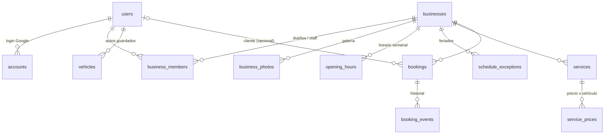

# Base de datos

Postgres + [Drizzle ORM](https://orm.drizzle.team). El esquema vive en `src/db/schema.ts` y las migraciones SQL en `drizzle/`.

## Diagrama



## Tablas

| Tabla | Para qué |
|---|---|
| `users` | Cualquier persona que inició sesión (cliente o dueño). Un mismo usuario puede ser las dos cosas. |
| `accounts`, `sessions`, `verification_tokens` | Las pide Auth.js. Las sesiones van en JWT, así que `sessions` queda vacía. |
| `businesses` | El lavadero (tenant). Datos públicos, ubicación y **reglas de agenda**: `capacity`, `slot_interval_minutes`, `min_lead_minutes`, `max_days_ahead`, `cancel_window_minutes`, `requires_approval`. Estado `draft → active → suspended`. |
| `business_members` | Quién administra cada lavadero (`owner` / `staff`). Reemplaza el `tenantId` en el usuario del sistema viejo: un usuario puede tener varios lavaderos. |
| `business_photos` | Galería del lavadero (hasta 12 fotos), con orden. Los archivos van a Vercel Blob (en desarrollo, a `public/uploads`). El logo y la portada están en `businesses.logo_url` / `cover_url`. |
| `opening_hours` | Horario semanal. Varias filas por día = varios tramos (9–13 y 15–20). |
| `schedule_exceptions` | Una fecha puntual. Si hay al menos una fila para esa fecha, **reemplaza** el horario semanal: con `start/end = null` está cerrado; con horario, abre solo en esos tramos. |
| `services` | Lo que ofrece el lavadero, con orden y visibilidad. |
| `service_prices` | Precio y duración de un servicio **para cada tipo de vehículo** (`auto`, `suv`, `pickup`, `moto`). Si no hay fila, ese servicio no se ofrece para ese vehículo. |
| `vehicles` | Vehículos guardados del cliente, para no volver a tipear la patente. |
| `bookings` | El turno. Guarda un **snapshot** del servicio, precio, duración y vehículo, así cambiar precios o borrar servicios no rompe el historial. `starts_at`/`ends_at` son `timestamptz`. |
| `booking_events` | Auditoría: creado, cambio de estado, reprogramado, cancelado (quién y cuándo). |

## Decisiones importantes

- **Horas en dos formatos.** Los instantes (turnos) van en UTC (`timestamptz`). Los horarios "de reloj" del lavadero van en minutos desde la medianoche (`smallint`, 0–1440) en la zona del lavadero (`businesses.timezone`). La conversión está en `src/lib/time.ts`.
- **Capacidad, no "puestos".** La disponibilidad se calcula con la ocupación pico (barrido de eventos) contra `capacity`. Si mañana se necesitan boxes o empleados, se agrega una tabla `resources` y una columna `bookings.resource_id`; el motor (`src/lib/availability.ts`) ya está aislado para eso.
- **Sin doble reserva.** Toda creación o reprogramación corre en una transacción con `pg_advisory_xact_lock(business_id)` y vuelve a validar la disponibilidad adentro. Hay un test que dispara 5 reservas en paralelo al mismo horario con capacidad 2 y verifica que entran exactamente 2.
- **Estados del turno.** `pending → confirmed → in_progress → ready → completed`, más `cancelled` y `no_show`. Ocupan lugar: `pending`, `confirmed`, `in_progress`, `ready`. Transiciones permitidas: `STATUS_TRANSITIONS` en `src/lib/constants.ts`.
- **Plata en pesos enteros** (`integer`). Si algún día hace falta centavos o multi-moneda, se migra a `numeric(12,2)` + `currency`.
- **Búsqueda sin extensiones.** La función `unaccent_lower()` (migración `0001`) hace la búsqueda insensible a tildes sin depender de `unaccent`. La distancia es Haversine en SQL: alcanza para cientos de lavaderos; con miles conviene PostGIS.

## Comandos

```bash
npm run db:generate   # después de cambiar schema.ts → genera una migración nueva en drizzle/
npm run db:migrate    # aplica las migraciones a DATABASE_URL
npm run db:studio     # explorador visual de la base
npm run db:seed       # datos de prueba
```

Nunca edites una migración ya aplicada en producción: generá una nueva.
